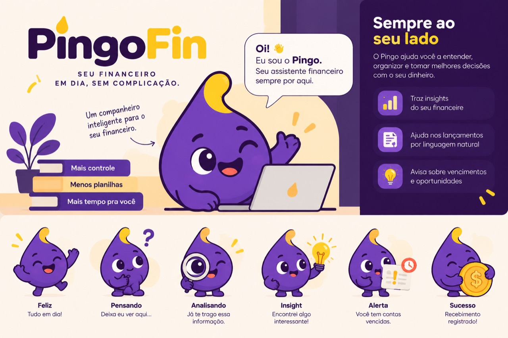

# PingoFin — Direção visual e design core

**Status:** direção visual definida; **direção de composição B (“Acolhedora”) escolhida em 05/10/2026** e registrada na [seção 16](#16-direção-b--acolhedora-registro-de-05102026). Demais tokens e medidas continuam propostas para validação durante a implementação.

**Data:** 05/10/2026.

**Referências:** [produto](./DEFINICAO_PRODUTO.md), [arquitetura](./ARCHITECTURE.md) e [identidade oficial do Pingo](./docs/assets/pingo-referencia.jpg).

## 1. Identidade e princípio visual

O produto se chama **PingoFin**. **Pingo** é seu assistente financeiro e mascote oficial, conforme a imagem fornecida pelo usuário.

A interface deve comunicar organização, clareza, proximidade e confiança. Deve ser moderna, amigável, simples, profissional e acessível para donos e funcionários de pequenos negócios sem formação financeira.

**Se houver conflito entre sofisticação e compreensão, priorizar compreensão.**

Roxo é a cor principal; amarelo é o destaque complementar. Azul não deve dominar a identidade. Evitar aparência de banco, ERP antigo, planilha ornamentada, dashboard genérico ou aplicativo infantil.

O design core, o shell e a alternância de tema estão implementados. A etapa visual atual acrescenta referências de gráficos e a interface local do Pingo; consulte [AGENTS.md](./AGENTS.md) e [docs/referencias-visuais](./docs/referencias-visuais/README.md) para escopo e assets.

## 2. Paleta de referência da marca

Os valores fornecidos são a referência inicial. Refinamentos para legibilidade preservam a identidade e devem ser explicitados nos tokens semânticos.

| Grupo | Referência | Valor | Aplicação |
| --- | --- | --- | --- |
| Roxo | Primary Purple | `#5B2A86` | Ações principais, marca e estados ativos |
| Roxo | Primary Dark | `#371653` | Sidebar e regiões pontuais de marca |
| Roxo | Primary Light | `#7C45B1` | Variações de marca e ações no tema escuro |
| Amarelo | Accent Yellow | `#FBBF24` | Highlights, detalhes e insights |
| Amarelo | Accent Dark | `#D99A00` | Variações de destaque |
| Amarelo | Accent Light | `#FFE7A3` | Fundos de destaque e detalhes suaves |
| Neutro | Background | `#FAF8FC` | Fundo claro com tendência discreta a lilás |
| Neutro | Surface | `#FFFFFF` | Superfícies principais |
| Neutro | Surface Secondary | `#F4F0F7` | Áreas secundárias e agrupamentos |
| Neutro | Border | `#E7E0EC` | Divisórias decorativas sutis |
| Neutro | Text Primary | `#241B2B` | Dados, títulos e texto principal |
| Neutro | Text Secondary | `#756A7C` | Texto secundário legível |
| Neutro | Text Muted | `#9B92A0` | Referência de tom discreto; uso depende do contraste |
| Funcional | Success | `#2E9D6F` | Confirmação, recebido, pago e resultado positivo |
| Funcional | Danger | `#D95757` | Erro, atraso e resultado negativo quando necessário |
| Funcional | Warning | `#E59B32` | Atenção e vencimento próximo |
| Funcional | Info | `#6E61A8` | Informação contextual |

Roxo aparece em navegação, sidebar, botões principais, estados ativos, elementos de marca e IA. Amarelo aparece em pequenos badges, ícones, detalhes do mascote, insights e chamadas secundárias; não deve ocupar grandes áreas da interface.

Verde, vermelho e laranja possuem significado funcional. Uma mensagem positiva de proximidade pode usar amarelo de marca, mas o status financeiro “Recebido” mantém sua semântica de sucesso. Nunca transmitir status somente por cor: combinar texto e, quando útil, ícone.

## 3. Design core preparado para temas

O design core deve nascer como uma camada compartilhada entre telas e componentes. Modo claro e escuro usam o mesmo vocabulário de tokens e a mesma estrutura; o tema altera os valores, sem duplicar componentes.

### Camadas de tokens

| Camada | Função | Exemplo |
| --- | --- | --- |
| Primitivos | Cores de origem, espaçamento, raio e tipografia | `brand.purple.primary`, `space.4` |
| Semânticos | Papel visual independente do tema | `color.bg`, `color.text.primary`, `color.action.primary.bg` |
| Componentes | Aliases necessários para usos recorrentes | `sidebar.bg`, `field.border`, `card.radius` |

Componentes consomem papéis semânticos. Evitar hexadecimal ou nomes de cor de utilitários espalhados pelas telas. Um valor de receita não deve usar “verde” diretamente; usa o papel “sucesso” quando o significado pede isso.

Regras financeiras, DTOs e serviços não dependem do tema. O pet também não ganha lógica de domínio.

### Organização futura no frontend

```text
design-core/
  primitives       # Paleta de marca e escalas compartilhadas
  semantic-tokens  # Mesmos papéis, valores light/dark
  typography       # Fonte, pesos, tamanhos e números
  component-tokens # Aliases usados por componentes

assets/styles/
  theme            # Variáveis CSS do design core
  base             # Tipografia e estilos globais mínimos

composables/
  useTheme         # Preferência e resolução do tema
```

Estrutura conceitual; nomes e extensões serão definidos conforme a versão do Nuxt/Tailwind escolhida. Não criar uma biblioteca ou instalar um plugin de tema apenas por padrão.

## 4. Tokens de cor: claro e escuro

**Proposta inicial:** claro com fundos suaves; escuro com neutros de tendência roxa, evitando grandes áreas de roxo saturado. Não inverter cores automaticamente. Os valores escuros são uma proposta técnica, ainda sujeitos à revisão visual.

| Token semântico | Claro | Escuro | Uso |
| --- | --- | --- | --- |
| `color.bg` | `#FAF8FC` | `#18121F` | Fundo da aplicação |
| `color.surface` | `#FFFFFF` | `#241B2D` | Superfície principal |
| `color.surface.secondary` | `#F4F0F7` | `#2E2338` | Área secundária |
| `color.border.subtle` | `#E7E0EC` | `#45364F` | Separação decorativa |
| `color.border.control` | `#8B8094` | `#8B7C95` | Contorno necessário para identificar campos/controles |
| `color.text.primary` | `#241B2B` | `#F6F0FA` | Conteúdo e números principais |
| `color.text.secondary` | `#756A7C` | `#C5B8CE` | Labels e conteúdo secundário |
| `color.text.muted` | `#756A7C` | `#B5A6BF` | Informação discreta que ainda precisa ser lida |
| `color.action.primary.bg` | `#5B2A86` | `#7C45B1` | Botão principal |
| `color.action.primary.hover` | `#371653` | `#6E379F` | Hover da ação principal |
| `color.action.primary.active` | `#371653` | `#5B2A86` | Estado pressionado |
| `color.action.primary.fg` | `#FFFFFF` | `#FFFFFF` | Texto/ícone sobre a ação principal |
| `color.accent.bg` | `#FBBF24` | `#FBBF24` | Destaques pequenos |
| `color.accent.fg` | `#241B2B` | `#241B2B` | Texto/ícone sobre amarelo |
| `color.brand.subtle.bg` | `#F0E8F7` | `#3B2752` | Seleção e contexto de IA |
| `color.brand.subtle.fg` | `#5B2A86` | `#E1C6FA` | Texto de marca sobre fundo sutil |
| `color.link` | `#5B2A86` | `#D1AEF2` | Links reconhecíveis também por estilo/contexto |
| `color.focus` | `#5B2A86` | `#FFE7A3` | Indicador de foco com separação da superfície |
| `sidebar.bg` | `#371653` | `#21152C` | Sidebar, opção A |
| `sidebar.fg` | `#F6F0FA` | `#F6F0FA` | Itens e títulos |
| `sidebar.fg.secondary` | `#D9C9E6` | `#D9C9E6` | Texto secundário |
| `sidebar.active.bg` | `#5B2A86` | `#5B2A86` | Item ativo |
| `sidebar.active.fg` | `#FFFFFF` | `#FFFFFF` | Texto do item ativo |

`color.text.muted` claro é refinado para preservar leitura; o tom original `#9B92A0` permanece na paleta de referência, sem virar automaticamente cor de placeholders ou textos úteis. `color.border.subtle` não substitui a borda de um campo quando ela é necessária para identificá-lo.

### Tokens de status

| Status | Fundo claro | Texto/ícone claro | Fundo escuro | Texto/ícone escuro |
| --- | --- | --- | --- | --- |
| Sucesso | `#E8F5EE` | `#1B7350` | `#18392C` | `#78D9AD` |
| Erro/atraso | `#FCECEC` | `#B33535` | `#45232C` | `#FFABAB` |
| Atenção | `#FFF4DF` | `#85520D` | `#40311E` | `#F7C477` |
| Informação | `#F0EBF8` | `#594A91` | `#302442` | `#C9B6F2` |

Esses pares correspondem a `color.status.<tipo>.bg` e `.fg`. São variantes funcionais da referência, com contraste adequado para labels pequenos. Para ícone/texto de status sem badge, validar também seu contraste sobre a superfície real.

## 5. Seleção e aplicação de tema

Contrato proposto: preferência `light | dark | system`, com resolução final `light | dark`.

1. Escolha explícita do usuário tem prioridade.
2. Na opção sistema, resolver por `prefers-color-scheme` e acompanhar mudanças.
3. Aplicar tema resolvido no elemento raiz, por exemplo `data-theme="light"` ou `data-theme="dark"`.
4. Trocar variáveis semânticas; componentes mantêm a mesma API.
5. Informar `color-scheme` correspondente para controles nativos e superfícies do navegador.

Pode-se persistir somente a preferência visual localmente. Isso não autoriza persistir tokens de autenticação ou dados financeiros no navegador. Definir a preferência antes da primeira pintura para evitar flash do tema errado.

Se houver SSR, resolver preferência com cookie compartilhado com o servidor quando necessário, manter estado por request e evitar divergência na hidratação. A implementação deve respeitar a escolha de renderização registrada na arquitetura.

Tailwind deve mapear os utilitários para variáveis CSS semânticas. Estados `dark:` ficam para diferenças específicas, não para repetir a definição de todos os componentes. Sintaxe de integração depende da versão ainda aberta; a [documentação do Tailwind](https://tailwindcss.com/docs/dark-mode) descreve seleção de tema e preferência do sistema. `color-scheme` coordena componentes nativos, conforme a [referência CSS](https://developer.mozilla.org/en-US/docs/Web/CSS/Reference/Properties/color-scheme).

**TBD:** preferência inicial padrão e posição do seletor. Recomendação: opção sistema disponível e modo claro como referência inicial de direção visual; definir o padrão ao prototipar. A base de tokens deve suportar os dois temas desde os primeiros componentes.

## 6. Contraste e acessibilidade

Adotar como critério de aceitação contraste mínimo de 4,5:1 para texto comum e 3:1 para texto grande; controles e informação gráfica necessária devem alcançar 3:1 contra cores adjacentes aplicáveis. Referências: [WCAG — texto](https://www.w3.org/WAI/WCAG22/Understanding/contrast-minimum.html) e [WCAG — elementos não textuais](https://www.w3.org/WAI/WCAG22/Understanding/non-text-contrast.html).

Valores abaixo foram calculados pela fórmula de luminância relativa sRGB para cores sólidas, sem transparência. A verificação não representa certificação de uma interface ainda inexistente.

| Par de referência | Contraste aproximado | Direção |
| --- | --- | --- |
| Branco sobre roxo `#5B2A86` | 9,90:1 | Adequado para botão principal claro |
| Branco sobre roxo `#7C45B1` | 6,28:1 | Adequado para botão principal escuro |
| `#241B2B` sobre amarelo `#FBBF24` | 9,93:1 | Usar texto escuro nos destaques amarelos |
| Branco sobre amarelo `#FBBF24` | 1,67:1 | Não usar para texto informativo |
| Muted original `#9B92A0` sobre branco | 2,99:1 | Insuficiente para texto comum; usar token refinado |
| Texto secundário `#756A7C` sobre `#F4F0F7` | 4,54:1 | Adequado; não aplicar opacidade adicional |
| Verde original `#2E9D6F` sobre branco | 3,40:1 | Não usar como label pequeno sem variante |
| Borda de controle clara `#8B8094` sobre branco | 3,74:1 | Adequada; também supera 3:1 nos fundos claros propostos |
| Texto principal escuro `#F6F0FA` sobre `#241B2D` | 14,78:1 | Adequado para conteúdo e números |

Os pares de badge de status propostos superam 4,5:1 nos dois temas. Hover, focus, pressed, disabled, fundos alternados e transparências precisam ser verificados nos componentes finais.

- Foco de teclado visível, sem depender só de mudança sutil de cor. Separar o anel da superfície quando necessário.
- Labels persistentes nos campos; placeholder não substitui label.
- Ícones sem texto precisam de nome acessível; status financeiros têm texto visível.
- Não reduzir opacidade dos números ou mensagens necessárias para “ficar elegante”.
- Amarelo isolado sobre branco não delimita bem controles; se usado em botão, garantir contorno/forma reconhecível com contraste apropriado.
- Movimento discreto, respeitando `prefers-reduced-motion`; nenhum efeito contínuo compete com os valores.
- Estados loading, vazio, erro e indisponível continuam compreensíveis sem depender do mascote.

## 7. Tipografia e valores financeiros

Uma sans-serif legível, contemporânea e confortável em telas pequenas. Referências indicadas pelo usuário: Inter, Manrope, Plus Jakarta Sans, Geist ou equivalente já disponível. **Escolhida com a direção B: Manrope** (variável 200–800, OFL 1.1), carregada localmente; pesos e fallback na [seção 16](#16-direção-b--acolhedora-registro-de-05102026). A aprovação definitiva da marca continua TBD.

Escala inicial proposta:

| Papel | Tamanho | Peso | Observação |
| --- | --- | --- | --- |
| Texto principal de interface | 16px | 400–500 | Boa leitura em mobile |
| Label/tabela secundária | 14px | 400–500 | Contraste preservado |
| Título de seção | 20–24px | 600 | Hierarquia clara; implementado 20px/700 |
| Título da página | 28–32px | 600–700 | Ajustar em telas pequenas; implementado 30px desktop, 28px ≤ 640px |
| Valor principal de saldo | 32–40px | 600–700 | Sem esconder centavos ou unidade |
| Outros indicadores | 24–28px | 600 | Consistência entre métricas |

Números financeiros usam numerais tabulares quando a fonte suportar, alinhamento à direita em tabelas e formatação brasileira: **R$ 18.420,30**. Separar label e valor; permitir valores negativos e grandes sem truncar o dado essencial. Cor pode reforçar resultado, mas sinal e label sustentam o significado.

Preservar os valores monetários exatos e contratos de strings definidos na arquitetura. Formatação visual não altera aritmética; não converter dinheiro para `float` para simplificar componentes.

## 8. Espaçamento, forma e profundidade

- Linguagem predominantemente flat/2D, em sintonia com o Pingo.
- Escala inicial de espaço: 4, 8, 12, 16, 24, 32 e 48px.
- Cantos moderados: 8px em controles; 12–16px em cards; ajustar conforme contexto.
- Cards brancos no claro e `color.surface` no escuro; borda sutil e padding confortável de 16–24px. **Atualizado pela direção B:** superfícies usam elevação 1 (sombra muito leve no claro; no escuro a separação vem da borda), detalhada na seção 16.
- Sombras pequenas apenas quando ajudam a distinguir camadas, como menus/modais. No escuro, priorizar contraste de superfície e bordas.
- Espaço em branco e seções delimitadas organizam a tela; não embrulhar cada grupo em card.
- Evitar card dentro de card, glassmorphism exagerado, 3D, brilhos, sombras pesadas, excesso de gradientes e padrão de IA azul/roxo neon.

Essas medidas são referências de composição, não medidas copiadas do Figma.

## 9. Sidebar e navegação

Explorar primeiro **opção A: sidebar roxa escura e conteúdo claro**, com contraste e densidade equilibrados. **Implementada** na composição B como painel recuado com cantos de 16px (seção 16). Amarelo entra em pequenos detalhes. **Opção B**, sidebar clara com ativo roxo, continua alternativa se a primeira ficar pesada.

Item ativo deve ter fundo/indicador e texto legíveis; não depender somente de cor. Ícones simples e consistentes acompanham labels. Navegação mantém os grupos de produto: visão geral, financeiro, clientes, relatórios, assistente e configurações, sujeitos à validação do MVP.

No mobile, menu pode virar drawer acessível, com controle explícito, foco gerenciado e fechamento previsível. Não reduzir a navegação a ícones indecifráveis. Tema escuro conserva a hierarquia visual sem tornar o conteúdo principal excessivamente roxo.

## 10. Dashboard, tabelas e formulários

Ordem visual do dashboard:

1. Saldo atual.
2. Entradas.
3. Saídas.
4. Resultado.
5. A receber.
6. A pagar.
7. Vencimentos e atrasos.
8. Informações e insights relevantes.

O dashboard responde à situação financeira em poucos segundos. Gráficos só entram para responder perguntas reais; não preencher espaços com visualizações decorativas. Insights não competem com saldo, pendências ou ações urgentes.

Labels identificam período e base do indicador. Não exibir venda como dinheiro recebido nem acumulado sem referência inicial como saldo disponível comprovado. Um número fictício ou estimado não pode parecer dado real da organização.

Tabelas devem facilitar comparar valores, datas e status: alinhamento monetário consistente, ações compreensíveis e cabeçalhos claros. Evitar excesso de badges e variações cromáticas. Usar linhas/divisórias suficientes sem produzir uma grade pesada.

Formulários têm labels, grupos objetivos, erros próximos ao campo e total/parcelas fáceis de conferir. A revisão de um lançamento de IA mantém o mesmo padrão dos formulários manuais, com confirmação explícita e campos faltantes visíveis.

Responsividade prioriza dashboard, lançamento, baixa e consulta. No mobile, adaptar colunas e grupos sem esconder valores/status; rolagem horizontal pode ser usada quando a comparação realmente precisar de tabela. Validar a partir de 320px de largura e com zoom, sem sobreposição de ações.

## 11. IA integrada e linguagem

Roxo, amarelo e Pingo identificam a assistência. Integrar análise, atalhos e pequenos insights ao contexto financeiro; evitar aparência de chatbot anexado à aplicação.

Preferir linguagem humana:

| Preferir | Evitar |
| --- | --- |
| Você ainda tem R$ 2.400 para receber. | Saldo consolidado de contas a receber: R$ 2.400. |
| 3 contas vencem esta semana. | Terminologia contábil desnecessária para uma ação simples |
| Pingo encontrou algo interessante. | Texto técnico sobre modelo, tokens ou infraestrutura |

“Seus gastos com combustível aumentaram 18%” só aparece quando dados e cálculo do backend sustentam a comparação. Falta de dados exige mensagem clara; não criar afirmações para preencher empty states.

Processamento e confirmação são estados distintos. Mostrar “Recebimento registrado” apenas depois de a API confirmar persistência; animação ou resposta do modelo não significa que a operação foi concluída.

## 12. Pingo — identidade e assets



A imagem foi copiada integralmente, sem alterações, para [docs/assets/pingo-referencia.jpg](./docs/assets/pingo-referencia.jpg). É uma prancha de referência em JPEG, com identidade e estados; não é ainda um conjunto de assets isolados/transparente pronto para componentes.

Preservar: silhueta inspirada em gota, corpo roxo, detalhe amarelo, expressão amigável, contornos simples e estilo 2D. Não substituir por emoji, robô, ícone genérico de IA ou personagem 3D. Exemplos derivados devem manter a identidade oficial.

Estados futuros: normal, feliz, pensando, analisando, insight, alerta e sucesso. Variações devem manter proporções, identidade e linguagem gráfica da referência. Não aplicar filtros de inversão ou recoloração automática para adaptar o personagem ao dark mode; ajustar sua superfície de apoio e eventual asset validado.

Usos apropriados: assistente, análise em processamento, lançamento por texto, empty states, insights, mensagens de sucesso e alertas contextuais. Presença pontual; não colocar o personagem em todas as telas nem sobrepor valores.

Há três [exemplos individuais do Pingo](./docs/referencias-visuais/README.md#2-pingo-imagens-individuais), gerados a partir da referência oficial com fundo transparente: normal, pensando e insight. O catálogo `frontend/app/config/visual-references.ts` permite substituição independente. São propostas para validação; a prancha original permanece intacta. **TBD:** aprovação final dos assets, versões da marca e animação. O chatbox atual não possui integração de IA.

## 13. Referência estrutural Figma

[Horizon UI — referência acessível indicada pelo usuário](https://www.figma.com/design/GvdP43pVkG1wNryDPczmlY/Horizon-UI---Trendiest-Open-Source-Admin-Template-Dashboard--Community-?node-id=0-1).

Usar para estudar estrutura, proporções, grid, disposição de dashboard, sidebar, tabelas, formulários, componentes e responsividade. A identidade, os textos, a paleta e os assets finais continuam sendo do PingoFin. Não copiar decisões incompatíveis com a clareza ou com o escopo do produto.

**Acesso confirmado em 05/10/2026:** o novo arquivo foi lido pelo conector Figma seguindo a skill `figma-use`. Foram identificadas as páginas `Introduction`, `-> Horizon UI Pages (Light Mode)` e `-> Horizon UI Pages (Dark Mode)`. A estrutura dos frames foi consultada e os dashboards claro e escuro foram inspecionados visualmente por screenshots. Nenhum nó do design foi criado ou editado.

| Referência identificada | Claro | Escuro | Evidência |
| --- | --- | --- | --- |
| Main Dashboard | `201:1804`, 1920 × 1732px | `201:2947`, 1920 × 1769px | Estrutura consultada e screenshots inspecionados |
| Tables | `101:9569`, 1920 × 1152px | `101:11972`, 1920 × 1152px | Frames identificados na estrutura |
| Sign In | `101:9004`, 1920 × 1152px | `101:11411`, 1920 × 1152px | Frames identificados na estrutura |

Profile, Kanban e NFT Marketplace também existem nas duas páginas; sua presença não acrescenta essas funcionalidades ao MVP do PingoFin.

Observações úteis para a adaptação:

- O dashboard claro tem sidebar de 290px e uma área principal organizada em indicadores no topo, gráficos e tabelas abaixo. Usar a hierarquia como referência, adaptando quantidade e prioridade dos indicadores ao MVP.
- Os screenshots mostram o mesmo arranjo geral nos dois temas. Isso reforça a proposta de manter componentes/estrutura e trocar tokens semânticos, sem exigir duas implementações de tela.
- A sidebar clara do template não substitui a preferência inicial do PingoFin por sidebar roxa escura. Os fundos azulados do modo escuro também devem ser adaptados à paleta própria.
- Há muitos gráficos, tarefas, calendário e blocos promocionais no template. Aproveitar apenas os padrões que atendam às perguntas e ações financeiras previstas no produto.
- As medidas acima descrevem frames desktop da referência; não definem breakpoints, layout mobile ou comportamento de sidebar da aplicação.

**TBD:** inspeção detalhada de tabelas/formulários e validação de responsividade, interação e biblioteca de componentes quando necessárias à implementação. Screenshots de dois temas não comprovam um mecanismo de alternância nem uma biblioteca já baseada em tokens.

## 14. Critérios para a implementação visual

- Todas as superfícies, textos, campos, bordas, ações, estados e overlays usam tokens com valores claro/escuro.
- Alterar o tema não exige reescrever telas e não muda os dados financeiros.
- Valores, status, foco e erros permanecem legíveis nos dois temas.
- Sidebar roxa e amarelo controlado reforçam a identidade sem pesar o dashboard.
- O Pingo mantém sua aparência e aparece onde ajuda a experiência.
- Interface e cópia priorizam usuários não técnicos e tarefas curtas.
- Conferir os componentes nos estados default, hover, focus, pressed, disabled, loading, vazio, erro e sucesso, nos dois temas.
- Validar números longos/negativos, navegação por teclado, mobile, zoom e preferência de movimento reduzido.
- Cores da marca não são usadas como substituto de autorização, cálculo ou confirmação de persistência.

## 15. Decisões e pendências

**Definido:** nome PingoFin, assistente Pingo, roxo/amarelo, referência oficial do personagem, estilo 2D, prioridade de clareza e design core com suporte a temas desde a base.

**Proposto para validação:** mapeamento de tokens claro/escuro, variantes de contraste, escalas de tipografia/espaçamento, opção A de sidebar e estratégia de preferência de tema.

**Aprovado em 05/10/2026:** direção de composição B (“Acolhedora”), fonte Manrope, sidebar roxa recuada, navbar com glass discreto, elevação leve das superfícies, densidade confortável e presença do Pingo junto à ação principal.

**TBD:** aprovação definitiva da marca e da fonte, valores definitivos do tema escuro, padrão do seletor de tema, assets de produção e variantes do Pingo, animação e adaptação responsiva/interativa dos padrões Figma. Esses pontos não alteram a direção visual já definida. TBDs financeiros, comerciais e arquiteturais seguem nos documentos de produto e arquitetura.

## 16. Direção B · Acolhedora (registro de 05/10/2026)

Escolhida entre duas propostas renderizadas para a mesma tela (listagem de empresas da administração), com capturas equivalentes em `docs/referencias-visuais/capturas/propostas/`. A direção A (“Estrutura”) foi descartada e removida do código. **Aprovado** indica o que foi visto e escolhido; **experimental** indica ajustes feitos na implementação, ainda sem validação explícita.

### Composição

| Elemento | Decisão | Estado |
| --- | --- | --- |
| Shell | Fundo `color.bg`, padding 16px; sidebar recuada de 272px, roxa (`sidebar.bg`), cantos 16px, fixa na rolagem | Aprovado |
| Navbar | Superfície flutuante com glass discreto: trilha e o único `<h1>` da página à esquerda, ações agrupadas à direita | Aprovado |
| Conta e tema | Um menu de conta (identidade, aparência clara/escura/sistema, sair); o tema saiu da navbar para reduzir controles | Experimental |
| Home de área | Resumo com total vindo da API + card do Pingo junto da ação principal | Aprovado |
| Toolbar de lista | Título e filtros na mesma linha; situação em controle segmentado, busca com botão explícito | Aprovado (segmento preenchido: experimental) |
| Tabela | Linhas de 64px, nome em destaque com metadado abaixo, números à direita; até 640px vira cartões empilhados | Aprovado |
| Pingo flutuante | Launcher de 56px no canto inferior direito; painel não modal de 380px no desktop, modal em tela cheia no mobile | Experimental |

### Tipografia

Manrope Variable (`@fontsource-variable/manrope` 5.3, licença SIL OFL 1.1), importada pelo `nuxt.config.ts` e servida pelo próprio bundle, sem requisição externa. Subconjuntos por `unicode-range` cobrem português e acentos. Fallback: `ui-sans-serif, system-ui, Segoe UI, sans-serif`. Numerais tabulares por `font-variant-numeric` (classe `tabular`).

| Token | Valor | Uso |
| --- | --- | --- |
| `--type-body` / `--type-secondary` | 16 / 14px | Texto, labels e metadados; nada abaixo de 14px |
| `--type-section` | 20px · 700 | Títulos de seção e de cards |
| `--type-page` | 30px (28px até 640px) · 700, `-0.02em` | `<h1>` na navbar |
| `--type-balance` | 40px (32px até 640px) | Indicador principal de um resumo |
| `--weight-brand` | 800 | Somente o logotipo e números de destaque |

### Forma, densidade e profundidade

| Token | Valor | Componentes |
| --- | --- | --- |
| `--radius-inner` | 6px | Badges, segmentos, peças internas |
| `--radius-control` | 8px | Botões, campos, itens de menu, avatar |
| `--radius-popover` | 12px | Menus, listas flutuantes, balões |
| `--radius-card` | 16px | Cards, sidebar, navbar, diálogos, painel do Pingo |
| `--control-height` / `--control-height-compact` | 44 / 36px | Altura padrão e controles dentro de grupos |
| `--table-row-min-height` | 64px | Linhas de tabela |
| `--elevation-1` | sombra leve (claro), quase nula (escuro) | Cards e navbar |
| `--elevation-2` | sombra média | Menus e launcher do Pingo |
| `--elevation-3` | sombra ampla | Diálogos e painel do Pingo |
| `--glass-bg` | superfície a 85% + `blur(16px)` | **Somente** a navbar; fallback opaco sem `backdrop-filter` |
| `--color-overlay` | roxo-escuro 50% (claro) / 65% (escuro) | Gaveta, diálogos e Pingo modal |

Glass não se aplica a tabelas, formulários ou conteúdo. A opacidade de 85% e a trilha em texto primário mantêm ao menos 12:1 mesmo com um botão roxo rolando sob a navbar (pior caso calculado). Pílulas (`rounded-full`) não são usadas.

### Seleção, foco e estados

`--color-selected-bg` / `--color-selected-fg` (claro `#5B2A86` com branco; escuro `#E1C6FA` com `#18121F`) marcam a opção escolhida em controles segmentados: 8,8:1 e 9,66:1 contra o fundo do grupo. O roxo `#7C45B1` foi descartado nesse uso no escuro por atingir só 2,36:1. Foco usa um único contorno de 2px (`color.focus`, afastamento de 2px; amarelo na sidebar). Disabled troca para superfície e texto secundários (4,54:1), sem opacidade sobre o texto. Item atual da navegação: fundo mais claro, texto branco, ícone amarelo, traço lateral e `aria-current`.

### Ícones e movimento

Lucide via `@lucide/vue` (o pacote `lucide-vue-next` está deprecado), importando ícone por ícone. Traço 1,75–2 e tamanhos 18/20px; ícones decorativos ficam ocultos e botões só com ícone têm nome acessível. O Pingo nunca é substituído por ícone: o item “Pingo” da navegação usa o asset individual.

Movimento: `--motion-fast` 120ms (hover, cor) e `--motion-base` 180ms (abrir painéis), somente opacidade e deslocamento de até 8px. `prefers-reduced-motion` anula as durações. Sem pulso infinito, parallax ou pose “pensando” simulando processamento.

### Componentes e camadas

shadcn-vue (estilo new-york-v4) fornece Button, Input, Label, Textarea, Select, DropdownMenu, Avatar, Table, Badge, Tooltip, Sheet, Dialog, Skeleton e Alert em `frontend/app/components/ui`, adaptados aos tokens e importados explicitamente. As variáveis shadcn (`background`, `foreground`, `card`, `popover`, `primary`, `muted`, `accent`, `border`, `input`, `ring`, `sidebar`) apontam para os semânticos em `design-core/component-tokens.css`. No Tailwind do PingoFin, `secondary` significa **texto secundário**, nunca fundo. Estilos globais ficam em `@layer base`/`components`, para que utilitários prevaleçam sem `!important`.

Camadas (`--layer-*`): navbar fixa 20, Pingo 40, menus, tooltips, gaveta e diálogos 50 (empilhados por ordem de abertura).

### Padrões de navegação, tabelas e formulários

- A navegação mostra apenas telas existentes; Kanban interno e páginas de desenvolvimento nunca aparecem.
- Tabelas: cabeçalho de 14px/600 em texto secundário, valores numéricos à direita, situação sempre com texto e ícone.
- Formulários: largura de leitura até 720px, grupos com `legend`, labels permanentes, erro abaixo do campo, ação principal antes da secundária.
- Estados: carregamento com skeleton no formato do conteúdo, vazio com orientação útil, erro com “Tentar novamente”, sucesso somente após confirmação da API.
