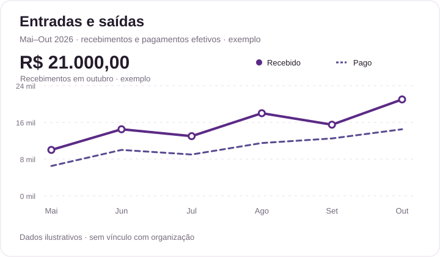

# Referências visuais — PingoFin

**Data:** 05/10/2026. **Status:** exemplos visuais para validação; dados sintéticos e imagens substituíveis.

Esta pasta reúne a referência oficial do Pingo, imagens individuais geradas a partir dela, exportações do Horizon UI e gráficos adaptados à identidade PingoFin. Consulte também [DESIGN_SYSTEM.md](../../DESIGN_SYSTEM.md), [AGENTS.md](../../AGENTS.md) e o [manifesto de procedência](./manifest.json). [ARCHITECTURE.md](../../ARCHITECTURE.md) serve como exemplo e contexto técnico; sua lista de módulos planejados não amplia o escopo desta etapa.

## 1. Galeria e interface

Inicie o frontend com `../scripts/npm.ps1 run dev` a partir de `frontend/` e abra [a galeria local](http://localhost:3000/dev/referencias). Ela só funciona em desenvolvimento, não depende de autenticação nem lê dados financeiros de uma organização. Use o seletor para comparar claro e escuro.

A página autenticada `/assistente` usa o mesmo chatbox. É necessário escolher uma organização. Mensagens ficam somente na memória do componente; mudar de organização ou sair da página limpa a conversa. Envio vazio é bloqueado, texto é renderizado sem HTML e o limite é 2.000 caracteres. Não há respostas simuladas, provider, API de IA, persistência ou lançamento financeiro.

## 2. Pingo: imagens individuais

Referência oficial preservada: [prancha original](../assets/pingo-referencia.jpg). Cópia local de consulta: [pingo-referencia-original.jpg](./pingo/pingo-referencia-original.jpg).

| Estado | Arquivo | Uso visual |
| --- | --- | --- |
| Normal | [pingo-normal.png](./pingo/pingo-normal.png) | Avatar e boas-vindas do chat |
| Pensando | [pingo-pensando.png](./pingo/pingo-pensando.png) | Exemplo de estado de espera; não implica processamento conectado |
| Insight | [pingo-insight.png](./pingo/pingo-insight.png) | Exemplo de orientação/descoberta; não implica análise real |


São PNGs com canal alfa, gerados individualmente com a ferramenta integrada `image_gen`, mantendo a identidade da referência. São propostas para revisão, não arquivos vetoriais nem assets finais aprovados. [Prompts completos](./pingo/prompts.json) registram as instruções de cada estado.

Para trocar uma imagem, substitua somente seu PNG e execute `./scripts/sync-visual-references.ps1` na raiz. Se mudar nome/estado, atualize também `pingo-front-crm/app/config/visual-references.ts` e `manifest.json`. Preserve proporções com `object-fit: contain`; não aplicar filtros de recoloração no dark mode. Para alterações de pose, regenerar usando a prancha e o prompt do estado; PNG não possui camadas editáveis.

## 3. Gráficos: fontes editáveis

| Pergunta visual | Claro | Escuro | Padrão de referência |
| --- | --- | --- | --- |
| Como variam os recebimentos e pagamentos? | [fluxo-caixa-light.svg](./graficos/fluxo-caixa-light.svg) | [fluxo-caixa-dark.svg](./graficos/fluxo-caixa-dark.svg) | Card largo, duas séries, resumo e legenda |
| Em quais dias entrou dinheiro? | [recebimentos-semana-light.svg](./graficos/recebimentos-semana-light.svg) | [recebimentos-semana-dark.svg](./graficos/recebimentos-semana-dark.svg) | Barras, grade discreta e labels por dia |
| Quais categorias concentram pagamentos? | [despesas-categoria-light.svg](./graficos/despesas-categoria-light.svg) | [despesas-categoria-dark.svg](./graficos/despesas-categoria-dark.svg) | Distribuição, total central e legenda explícita |



Os seis SVGs possuem textos, grupos identificados, séries e cores editáveis. Abrir em editor de texto ou importar no Figma. A fonte canônica é [scripts/generate-visual-references.mjs](../../scripts/generate-visual-references.mjs); editar séries, títulos ou paletas ali e executar:

```powershell
./.tools/node-v24.21.0-win-x64/node.exe ./scripts/generate-visual-references.mjs
./scripts/sync-visual-references.ps1
```

O gerador atualiza as fontes em `docs/` e as cópias públicas em `frontend/`. A paleta reproduz os papéis do design system para estes exemplos exportados; mudanças de tokens devem ser refletidas nas paletas do gerador. Esses SVGs não são gráficos vivos: não têm consultas, cálculo de saldo, filtros, tooltips ou integração com backend.

Cada card identifica dados ilustrativos. Os conjuntos são independentes, não representam uma mesma organização nem devem ser somados entre gráficos. Entradas/saídas significam recebimentos/pagamentos no exemplo, não vendas previstas. Na implementação futura usar valores exatos fornecidos pelo backend e descrições acessíveis; não reutilizar essas séries como dados do usuário.

## 4. Horizon UI: referência original

[Arquivo anexado no Figma](https://www.figma.com/design/GvdP43pVkG1wNryDPczmlY/Horizon-UI---Trendiest-Open-Source-Admin-Template-Dashboard--Community-?node-id=201-1804). Autor: **Simmmple**. Origem pública: [Horizon UI na Community](https://www.figma.com/community/file/1098131983383434513), publicado sob CC BY 4.0. Conservar atribuição ao reutilizar as referências originais.

| Exportação | Node ID | Conteúdo |
| --- | --- | --- |
| [horizon-dashboard-light.png](./horizon/horizon-dashboard-light.png) | `201:1804` | Dashboard claro original |
| [horizon-barras.png](./horizon/horizon-barras.png) | `201:1918` | Medium_Traffic |
| [horizon-distribuicao.png](./horizon/horizon-distribuicao.png) | `201:1949` | Medium_Pie Chart |

A página clara `0:1` foi consultada com `figma-use`; o card de linhas `201:1835` (Large_Double Chart2) foi identificado e inspecionado na exportação do dashboard. O limite do conector Figma impediu exportações adicionais. A referência externa não foi alterada. As PNGs são evidência da referência; os SVGs PingoFin são os exemplos editáveis locais.

## 5. Estrutura e substituição

```text
docs/referencias-visuais/
  README.md                  Guia visual e procedência
  manifest.json              Catálogo e estado dos assets
  pingo/                     Prancha, três PNGs e prompts
  graficos/                  Três gráficos × dois temas, em SVG
  horizon/                   Exportações originais do Figma
  capturas/                  Evidência da galeria/interface validada
```

Não utilizar a prancha ou exportações do dashboard como imagens de interface. O frontend referencia apenas os assets individuais pelo catálogo `visual-references.ts`. Preserve nomes estáveis para simplificar substituições e execute a sincronização após cada troca.

## 6. Validação desta etapa

Conferência realizada em 05/10/2026: typecheck, lint, formatação, sete testes existentes e build do frontend concluídos com sucesso. Galeria inspecionada em claro/escuro e em viewport mobile de 390 × 844, sem rolagem horizontal. As oito imagens da página carregaram corretamente.

No chat foram conferidos sugestões que preenchem o campo, bloqueio de mensagem vazia, limite de 2.000 caracteres, envio local, limpeza do campo e desaparecimento da conversa após recarregar. Texto contendo marcação HTML permaneceu texto literal. A interface autenticada mantém a proteção existente e recria o componente ao trocar a organização; esse fluxo autenticado não foi exercitado nesta conferência visual.

Capturas: [claro](./capturas/galeria-light.png), [escuro](./capturas/galeria-dark.png), [mobile escuro](./capturas/galeria-mobile-dark.png) e [prévia do Pingo](./capturas/pingo-interface.png). As capturas documentam exemplos, não dados reais nem respostas de IA. Nenhuma alteração no backend foi necessária.

## 7. Direção visual B e capturas do refinamento

Em 05/10/2026 foram comparadas duas direções renderizadas para a listagem de empresas da administração; a direção **B · Acolhedora** foi escolhida e registrada no [DESIGN_SYSTEM §16](../../DESIGN_SYSTEM.md#16-direção-b--acolhedora-registro-de-05102026). Capturas equivalentes das duas propostas: `capturas/propostas/`. Antes e depois das telas reais: `capturas/refinamento/antes/` e `capturas/refinamento/depois/` (desktop 1440 × 900 gravado pela ferramenta em 800 × 500; mobile 375 × 812 e 320 × 700; zoom de 200% simulado em 720 × 450).

A galeria passou a incluir uma **prévia de dashboard financeiro** (`components/preview/DashboardPreview.vue`) com valores ilustrativos em texto, identificados por um selo “Dados ilustrativos”. Ela segue a hierarquia do DESIGN_SYSTEM §10 e não calcula nem lê dados de uma organização.

O nó Figma 201:2093 (navbar) não pôde ser consultado: o conector atingiu o limite de chamadas do plano Starter. A navbar foi composta com a exportação local 201:1804 e o design system, sem atribuir medidas ao nó.
